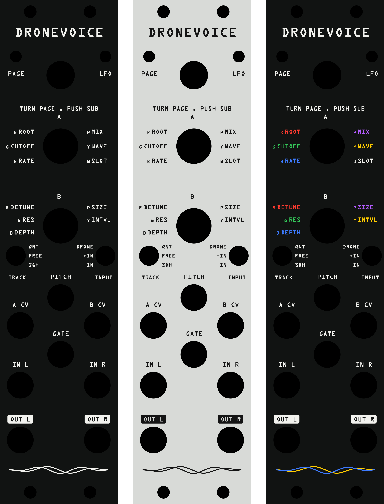

# DroneVoice Legio panel

Starter artwork for a 6 HP panel that labels Legio's controls for DroneVoice. The hole positions and sizes come from Noise Engineering's published Legio panel file (`legio_VI_24.svg` in [noiseeng/curiositas](https://github.com/noiseeng/curiositas/tree/main/panels), public domain).

**Before you order anything, check the jack labels.** Noise Engineering's file has holes but no labels, so the jack names here are a best guess. Compare them with a photo of a real Legio panel, fix the `JACKS` list in `make_panel.py`, and regenerate.

| Jack position | Label here |
| --- | --- |
| Centre, upper | PITCH (1 V/oct) |
| Left and right, first row | A CV, B CV (summed with the top and bottom knobs) |
| Centre, lower | GATE |
| Left and right, second row | IN L, IN R |
| Left and right, bottom row | OUT L, OUT R |

## Files

| File | Use |
| --- | --- |
| `dronevoice-legio-black.svg` | Black panel with white text. The `cut` layer (red hairlines) has the outline and holes |
| `dronevoice-legio-silver.svg` | Silver panel with black text, with the same `cut` layer |
| `dronevoice-legio-colour.svg` | Black panel with each knob legend in its page LED colour, with the same `cut` layer |
| `dronevoice-legio-colour-1200dpi.png` | The colour artwork as a 1200 dpi image (1417 × 6071 px), for full-colour UV printing services that want a bitmap |
| `dronevoice-legio-silk.svg` | The artwork alone, for a PCB's silkscreen layer |
| `dronevoice-legio-cuts.dxf` | Outline and holes only, in mm, for laser cutting, CNC or a PCB's board outline |
| `dronevoice-legio-preview.png` | Preview of the black, silver and colour versions |
| `make_panel.py` | Generates all of the above; edit labels and layout here |

All text is converted to outlines, so the files don't depend on fonts. To regenerate, run `python3 make_panel.py`; it needs matplotlib and the `fonts-ocr-a` package.

## What's on the panel

- **Top:** the title, the two LEDs (PAGE and LFO) and the encoder (turn for page, push for sub).
- **Beside each knob:** what the knob does on each page. The small letter in front of each word is the colour the page LED shows on that page: **R**ed, **G**reen, **B**lue, **P**urple, **Y**ellow, **W**hite. Knob A is the top knob and knob B the bottom one.
- **Switches:** TRACK (pitch input: quantised, free, sample and hold) and INPUT (drone, drone and input, input only), with the three positions labelled.
- **Jacks:** the outputs use reversed labels, so they stand out.

There are three versions. Black (white text) and silver (black text) are one colour, like Noise Engineering's own overlays. The colour version also tints each knob legend with its page LED colour, so a glance at the LED tells you which words apply.

The text is set in OCR-A, the typeface Noise Engineering uses on their website. Their site uses Adobe's commercial OCR A Std; this artwork uses John Sauter's public-domain OCR-A Bold (the `fonts-ocr-a` package on Debian and Ubuntu). The bold weight keeps strokes thick enough for silkscreen and engraving at these sizes. The text is converted to outlines, so the files don't need the font. To use DejaVu Sans Condensed instead, set `FONT_STYLE = "dejavu"` in `make_panel.py`.

## Ways to make it

**An overlay over the existing panel.** This is the easiest route, with no disassembly. Noise Engineering sells laser-etched acrylic overlays for Legio that fit over the stock panel; a custom one works the same way.
- Laser-cut and engraved acrylic: send the SVG to a laser-cutting service or a makerspace, cutting on the red layer.
- Printed: print the black or silver SVG on adhesive vinyl or photo paper, laminate it, then cut the outline and punch the holes.

Either way, remove the knobs first if the overlay's holes are smaller than the knobs.

**Colour.** Monochrome is the norm for Eurorack panels, but colour is possible:
- **PCB panel with colour printing:** JLCPCB offers multi-colour silkscreen, printed with a 6-colour UV printer at 1200 dpi. You import a JPG or PNG onto the silkscreen layer in EasyEDA; `dronevoice-legio-colour-1200dpi.png` is sized for that.
- **Aluminium:** panel services that UV-print on aluminium can print full colour from the SVG.
- **Printed overlay:** any colour printer works, on vinyl or photo paper.

**A replacement panel.** This replaces the stock panel, so the module has to come apart.
- **PCB panel (FR-4):** cheap, typically ordered in fives. Black solder mask with white silkscreen gives you the black version. Import the DXF as the board outline and the silk SVG as silkscreen, for example in KiCad. 1.6 mm boards are fine in practice; the Eurorack specification calls for 2 mm.
- **Aluminium:** engraved or printed panel services take the DXF for the holes and the SVG for the artwork. They're the sturdiest option, and black anodised aluminium with white print matches the black version.

**Fit.** Noise Engineering says their panel files are "use at your own risk", that measurements can change between revisions, and that they aren't responsible for fit. Check the hole spacing against your module before ordering, or test with a paper printout at 100% scale first. Their trademarks can't be used commercially, so this artwork carries no Noise Engineering names or logos.
